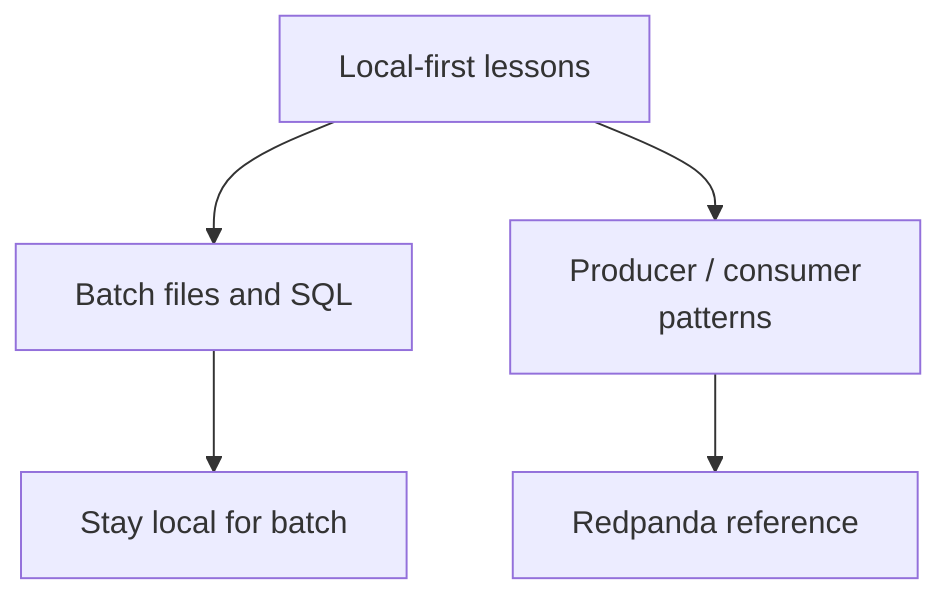

# Advanced Path

The beginner material in the root of this repository is the recommended learning path. This `03_advanced_optional/` folder is for students who already understand the local workflow and want to see how the same ideas appear with a real event broker.

## What is here?

- [stream_processing/](./stream_processing/): An optional Redpanda-based streaming workflow

## Why keep this separate?

Broker-based systems add important ideas, but they also add more moving parts:

- Broker or cluster setup
- Network ports
- Container orchestration
- More logs to debug
- More tools to learn before the core concepts click

The local-first curriculum removes those barriers at the start. Once you are comfortable with batch files, SQL, events and windows, the advanced section shows how those concepts scale out.

