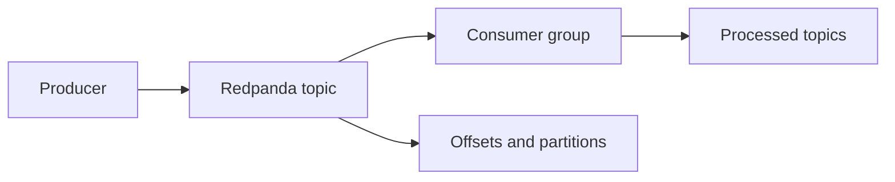
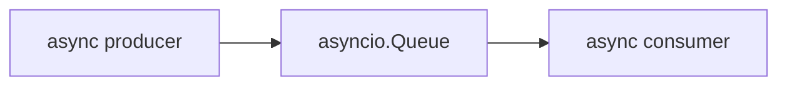
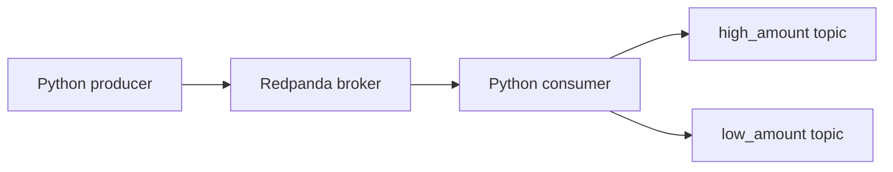

# What is Redpanda?

[Redpanda](https://docs.redpanda.com/current/get-started/intro-to-events/) is an event streaming platform that provides the infrastructure for streaming real-time data and is compatible with the Kafka API.

## Why use it in the advanced path?

The beginner lessons in this repository use `asyncio.Queue` so you can focus on concepts first. Redpanda is the next step if you want to see what changes once events move through a real broker.

- Producers send messages to topics.
- Consumers subscribe to topics.
- Brokers persist the event log.
- Partitions help a stream scale.
- Offsets keep track of what a consumer has read.

## Core ideas

### Topic

A topic is a named stream of messages, such as `rides_json`.

### Message

Each message contains a key, a value, and broker metadata such as an offset and a timestamp.

### Broker

A broker stores the topic log and serves producers and consumers. In this local demo, one Redpanda broker is enough.

### Partition

A topic can be split into partitions so that multiple consumers can work in parallel. Even if you only run one partition locally, the idea still matters because it explains how broker-based systems scale.

### Consumer group

A consumer group lets multiple consumers coordinate their work. Each partition is handled by only one consumer inside the group at a time.

## Beginner vs advanced mental model

The local-first notebook path uses an in-memory queue:

The advanced path replaces the in-memory queue with a durable broker:

## What to learn here

By the end of the Redpanda workflow, you should be able to:

1. Start a local broker with Docker Compose.
2. Produce events into a topic.
3. Consume events from that topic.
4. Split the stream into high-amount and low-amount rides.
5. Inspect the resulting topics in Redpanda Console.
