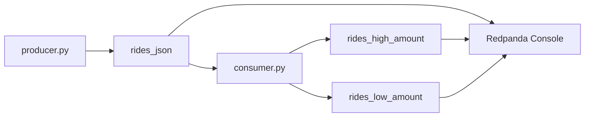

# Getting Started with Redpanda

This advanced workflow shows how to run a local Redpanda broker and route taxi-ride events into different topics based on the `total_amount` field.

It is intentionally separate from the main course because it adds:

- Docker setup,
- broker and topic lifecycle,
- more moving pieces to debug,
- network ports and container logs.

## Files in this folder

- `docker-compose.yaml`: starts Redpanda and Redpanda Console.
- `download_data.py`: downloads one Parquet file for the demo.
- `producer.py`: sends taxi rides into the source topic.
- `consumer.py`: reads the source topic and forwards records to high and low amount topics.
- `settings.py`: keeps the broker address and topic names in one place.

## Architecture



## 1. Start Redpanda

Make sure Docker Desktop or your local Docker daemon is running, then run:

```bash
cd 03_advanced_optional/stream_processing
docker compose up -d
```

Open <http://localhost:8080> to inspect the broker in Redpanda Console.

## 2. Create the topics

Use `rpk` inside the container:

```bash
docker compose exec redpanda-0 rpk topic create rides_json rides_high_amount rides_low_amount
```

## 3. Download the local Parquet file

```bash
uv run python download_data.py
```

This saves `yellow_tripdata_2025-01.parquet` into `data/raw/` at the root of the repository.

## 4. Start the consumer

In one terminal:

```bash
uv run python consumer.py
```

## 5. Start the producer

In another terminal:

```bash
uv run python producer.py
```

The producer sends a small set of taxi rides to `rides_json`. The consumer reads those events and forwards each ride into either `rides_high_amount` or `rides_low_amount`.

## 6. Inspect the results

You can use Redpanda Console or `rpk`:

```bash
docker compose exec redpanda-0 rpk topic consume rides_high_amount --num 4
```

```bash
docker compose exec redpanda-0 rpk topic consume rides_low_amount --num 5
```
