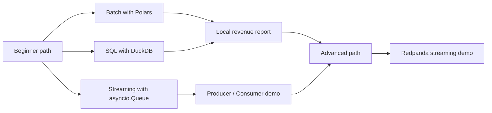
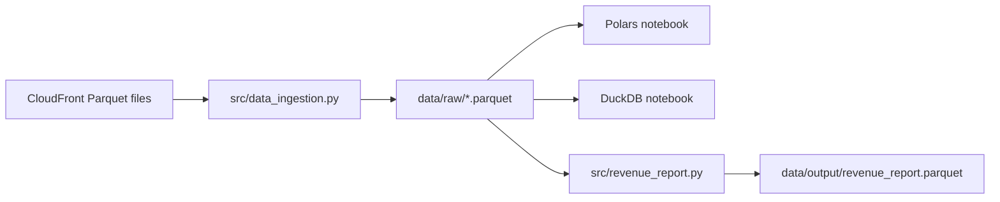
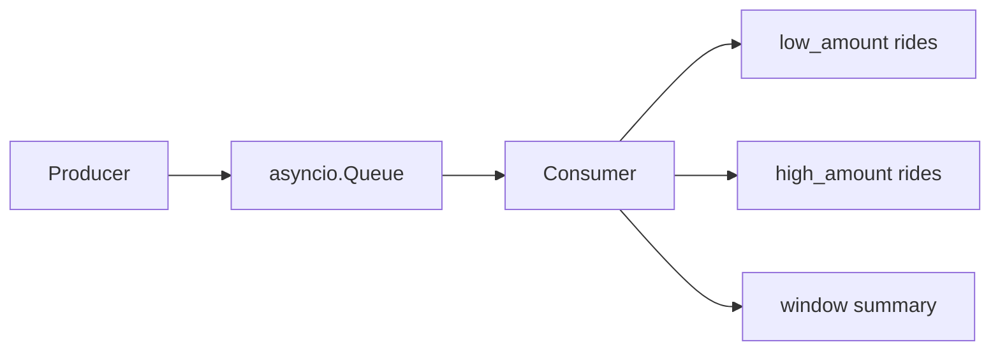

# Introduction to Batch and Stream Processing

This repository shows the difference between batch and stream processing with a setup that is realistic but small enough to run on your laptop. The beginner path is fully local and uses Python, `Polars`, `DuckDB` and `asyncio`. The advanced path is an optional `Redpanda` broker demo if you want to see a production-style event stream.

## Learning Objectives

By the end of this repository, you should be able to:

- Explain the difference between batch processing and stream processing.
- Load and explore Parquet data locally with Polars.
- Query local Parquet files with DuckDB and SQL.
- Build a reusable monthly revenue report from raw taxi data.
- Model a simple producer-consumer workflow with `asyncio.Queue`.
- Understand how the local streaming examples relate to a broker-based system such as Redpanda.

## Learning Path



### 01 - Batch Processing

Work with Parquet files on your own machine, first with DataFrames and then with SQL.

| File | Description |
|---|---|
| [**01 - Introduction to Polars**](01_batch_processing/01-intro-to-polars.ipynb) | Load Parquet data, inspect schemas, filter rows, and build simple grouped summaries with Polars. |
| [**02 - SQL with DuckDB**](01_batch_processing/02-intro-to-duckdb-sql.ipynb) | Query local Parquet files directly with SQL and practice grouped summaries without setting up a database. |
| [**03 - Build a Local Revenue Report**](01_batch_processing/03-build-a-local-batch-report.ipynb) | Turn raw taxi trips into a monthly revenue report and connect the notebook workflow to the CLI script. |

### 02 - Stream Processing

Move from "all the data at once" to "one event at a time".

| File | Description |
|---|---|
| [**01 - Introduction to Stream Processing**](02_stream_processing/01-intro-to-stream-processing.ipynb) | Use small taxi events to compare batch thinking with stream thinking, windows, and threshold-based routing. |
| [**02 - Producer and Consumer with asyncio**](02_stream_processing/02-producer-consumer-with-asyncio.ipynb) | Build a lightweight producer-consumer demo with `asyncio.Queue` and watch windowed summaries update as events arrive. |

### 03 - Advanced Path

> [!NOTE]
> The advanced path is optional. It is there to show how the same ideas appear once you are comfortable with the local version and want to try a real event broker. It needs Docker.

| File / Folder | Description |
|---|---|
| [**README**](03_advanced_optional/README.md) | Why the broker material is kept separate, and when to move on to it. |
| [**Redpanda Streaming Lessons**](03_advanced_optional/stream_processing/) | A producer, a consumer and a Redpanda broker running in Docker. |

### Additional Folders and Files

| File / Folder | Description |
|---|---|
| [**src**](src/) | Command-line versions of the lesson workflows, shared across the modules. |
| [**pyproject.toml**](pyproject.toml) | Project configuration and dependencies. |
| [**uv.lock**](uv.lock) | Dependency lock file. |

## Setup

> [!NOTE]
> Throughout these steps, text in angle brackets like `<repo-name>` is a
> **placeholder**. Replace it including the `< >` brackets with your own
> value. For example, `cd <repo-name>` becomes `cd mle-batch-and-stream-processing`.

### 1. Create the Repository from the Template

Click **Use this template** on GitHub.

When creating the repository:

- Set yourself as the **Owner**
- Choose a repository name
- Disable **Include all branches**
- Click **Create repository**

> [!IMPORTANT]
> If you are working in pairs or groups, only **one person** should complete this step.

---

### 2. Add Collaborators (Pairs/Groups Only)

If working with teammates:

1. Open the repository on GitHub
2. Go to **Settings → Collaborators**
3. Add your teammates as collaborators
4. Share the repository link with your team

Teammates should accept the invitation before continuing.

---

### 3. Clone the Repository

Copy the SSH URL from the **Code** button on GitHub, then run:

```bash
git clone <copied-ssh-url>
```

The copied SSH URL will look like `git@github.com:<your-username>/<repo-name>.git`.

---

### 4. Move into the Project Folder and Install Dependencies

This installs all dependencies and creates a virtual environment in (`.venv/`).

```bash
cd <repo-name>
uv sync
```

---

### 5. Open the Repository in VS Code

> [!NOTE]
> Make sure you open VS Code from the project root so it automatically detects the environment created by `uv sync`.

Launch VS Code in the project root folder:

```bash
code .
```

Then open a notebook and select the Python environment created by `uv sync` as the kernel.

## Typical Beginner Workflow

### 1. Download a few months of local data

```bash
uv run python src/data_ingestion.py --year 2025 --months 1 --months 2 --months 3 --output-dir data/raw
```

> [!NOTE]
> Each monthly file is roughly 60 MB. Files you already have are skipped, so it is safe to run this again.

### 2. Explore the data in the batch notebooks

The batch notebooks read from `data/raw/` and introduce DataFrame transformations, SQL over Parquet, and the final reporting task.



### 3. Build the report from the command line

```bash
uv run python src/revenue_report.py \
  --input "data/raw/yellow_tripdata_2025-*.parquet" \
  --output data/output/revenue_report.parquet
```

### 4. Run the streaming demo

Use the sample events:

```bash
uv run python src/stream_demo.py
```

Or stream from a local Parquet file:

```bash
uv run python src/stream_demo.py --input data/raw/yellow_tripdata_2025-01.parquet --limit 12
```



## References & Further Reading

- [Polars Documentation](https://docs.pola.rs/user-guide/getting-started/): The official introduction to DataFrames, expressions and lazy evaluation.
- [Coming from pandas](https://docs.pola.rs/user-guide/migration/pandas/): How Polars differs from pandas, and which habits to unlearn.
- [Reading and Writing Parquet Files with DuckDB](https://duckdb.org/docs/current/data/parquet/overview.html): Querying Parquet directly with SQL, including glob patterns.
- [Python Asyncio Queues](https://docs.python.org/3/library/asyncio-queue.html): The standard library primitive behind the producer-consumer lessons.
- [Introduction to Redpanda](https://docs.redpanda.com/current/get-started/intro-to-events/): Event streaming concepts behind the optional advanced path.
